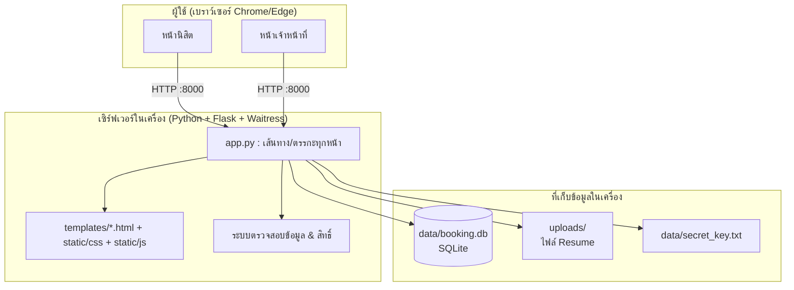
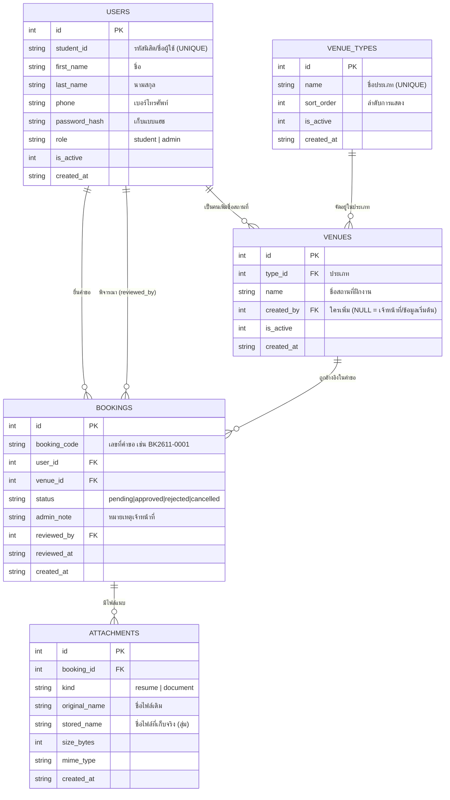
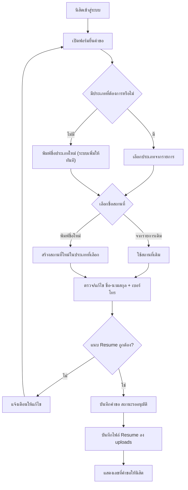
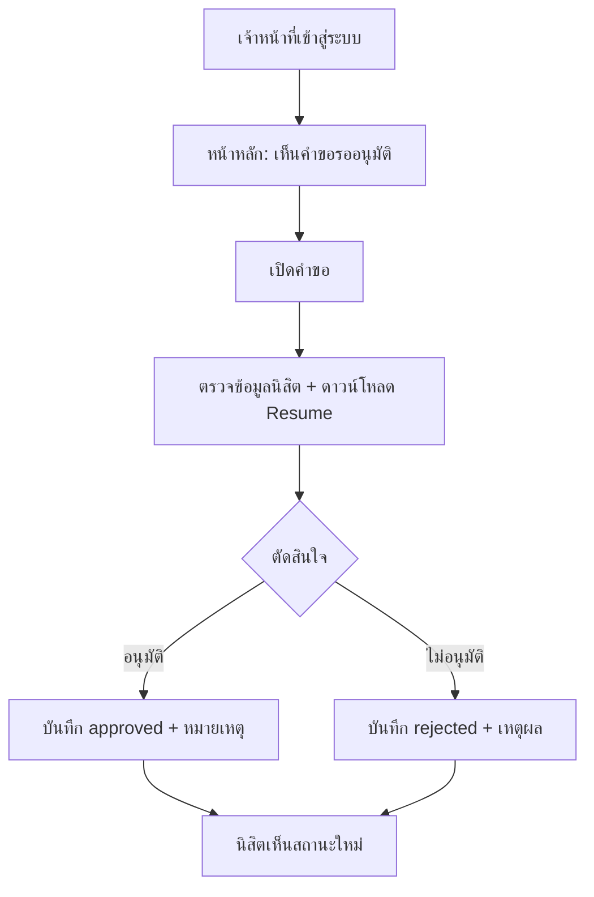
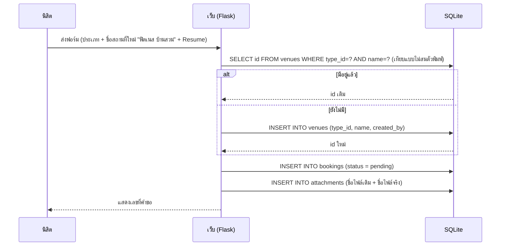

# เอกสารวิเคราะห์และออกแบบระบบ
## ระบบจองสถานที่ฝึกงาน พร้อมแนบไฟล์ Resume (Internship Venue Booking System)

| รายการ | รายละเอียด |
|---|---|
| ชื่อระบบ | ระบบจองสถานที่ฝึกงาน (Internship Venue Booking System) |
| ประเภท | Web Application (ใช้งานผ่านเบราว์เซอร์) |
| เทคโนโลยี | Python 3.12 + Flask 3 + SQLite 3 + HTML/CSS (Jinja2) + JavaScript เล็กน้อย |
| ฐานข้อมูล | SQLite ไฟล์เดียว `data/booking.db` (เปิดดูได้ในเครื่อง) |
| กลุ่มผู้ใช้ | 1) นิสิต 2) เจ้าหน้าที่/ผู้ดูแลระบบ (admin) |
| วันที่จัดทำ | 22 ตุลาคม 2569 (ปรับปรุงรอบที่ 3: แยกทางเข้านิสิต/เจ้าหน้าที่ + ปรับ UX/UI) |
| ขอบเขต | ลงทะเบียนสถานที่ฝึกงาน (แยกประเภท) + แนบ Resume + ระบบอนุมัติ + จัดการสถานที่ |

---

## 1. บทนำ

### 1.1 ปัญหาและความจำเป็น
การขอใช้/ลงทะเบียนสถานที่ฝึกงานในปัจจุบันมักใช้กระดาษ ข้อความในไลน์ หรือส่ง Resume ทางอีเมล ทำให้

- ไม่มีทะเบียนกลางว่าใครไปฝึกที่ไหน ประเภทใด (ฟิตเนส/อคาเดมี่/โรงเรียน/หน่วยงานราชการ)
- ไฟล์ Resume กระจัดกระจาย ค้นหายาก ไม่มีระบบจัดเก็บที่ปลอดภัย
- ตรวจสอบย้อนหลังไม่ได้ว่าใครอนุมัติ เมื่อไร เพราะอะไร
- สรุปจำนวน/สถิติแยกตามประเภทสถานที่ทำได้ยาก

### 1.2 วัตถุประสงค์
1. ให้นิสิตลงทะเบียนสถานที่ฝึกงานของตนเอง พร้อมแนบ Resume ได้ในที่เดียว
2. จัดหมวดหมู่สถานที่ฝึกงานเป็น **ประเภท** เพื่อการค้นหาและสรุปสถิติ
3. ให้นิสิต **เพิ่มชื่อสถานที่ใหม่ได้เอง** โดยไม่ต้องรอเจ้าหน้าที่ (ระบบจำไว้ใช้ซ้ำ)
4. ให้เจ้าหน้าที่อนุมัติ/ไม่อนุมัติ พร้อมหมายเหตุ และตรวจ Resume ได้จากหน้าเดียว
5. เก็บข้อมูลใน SQLite ที่เปิดดูได้ในเครื่อง เหมาะกับการส่งงาน/สาธิต และต่อยอดได้ง่าย

### 1.3 ขอบเขต (รอบที่ 2)
**อยู่ในขอบเขต**
- สมาชิก: สมัคร (ชื่อ/นามสกุล/รหัสนิสิต/เบอร์โทร), เข้าสู่ระบบ, โปรไฟล์, เปลี่ยนรหัสผ่าน
- นิสิต: ยื่นคำขอ (เลือกประเภท + เลือก/พิมพ์ชื่อสถานที่ + แนบ Resume), ดูสถานะ, ยกเลิก
- เจ้าหน้าที่: ภาพรวม/สถิติ, ค้นหา–กรองคำขอ, อนุมัติ/ไม่อนุมัติ, ดาวน์โหลด Resume,
  จัดการบัญชีนิสิต, เพิ่มชื่อสถานที่–เพิ่มประเภทสถานที่, ซ่อน/เปิดใช้สถานที่
- **ไม่มีวันที่และเวลา** (ไม่มีการตรวจเวลาทับซ้อนแล้ว เพราะไม่ใช่การจองเป็นช่วงเวลา)

**ยังไม่อยู่ในขอบเขต (แผนถัดไป)**
- รอบการฝึกงาน/ภาคเรียน, ปฏิทิน, พิมพ์ใบรับรองเป็น PDF, ส่งออก Excel
- แจ้งเตือนอีเมล/ไลน์, รวมชื่อสถานที่ซ้ำ (merge), บันทึก log การใช้งาน

---

## 2. ผู้ใช้งานและสิทธิ์

### 2.1 Use Case Diagram

```mermaid
graph LR
    N[นิสิต]
    A[เจ้าหน้าที่ / Admin]

    subgraph ระบบจองสถานที่ฝึกงาน
      UC1[สมัครสมาชิก]
      UC2A[เข้าสู่ระบบ (นิสิต · /login)]
      UC2B[เข้าสู่ระบบ (เจ้าหน้าที่ · /admin/login)]
      UC3[ยื่นคำขอลงทะเบียนสถานที่ + Resume]
      UC4[เลือกประเภทสถานที่]
      UC5[พิมพ์ชื่อสถานที่ใหม่]
      UC5B[เพิ่มประเภทสถานที่ใหม่ (พิมพ์เอง)]
      UC6[ดูสถานะ / ยกเลิกคำขอ]
      UC7[แก้ไขโปรไฟล์ / รหัสผ่าน]
      UC8[ดูภาพรวมและสถิติ]
      UC9[ค้นหา / กรองคำขอ]
      UC10[ดาวน์โหลด Resume]
      UC11[อนุมัติ / ไม่อนุมัติ]
      UC12[จัดการบัญชีนิสิต]
      UC13[จัดการสถานที่ / ประเภท]
    end

    N --> UC1
    N --> UC2A
    N --> UC3
    N --> UC6
    N --> UC7
    UC3 -.->|include| UC4
    UC3 -.->|extend| UC5
    UC3 -.->|extend| UC5B
    A --> UC2B
    A --> UC8
    A --> UC9
    A --> UC10
    A --> UC11
    A --> UC12
    A --> UC13
```

### 2.2 ตารางสิทธิ์การเข้าถึง

| หน้า / การทำงาน | นิสิต | เจ้าหน้าที่ (admin) |
|---|---|---|
| สมัครสมาชิก (สำหรับนิสิต) | ✔ | ✘ (บัญชี admin สร้างอัตโนมัติ) |
| เข้าสู่ระบบ | ✔ ที่ `/login` | ✔ ที่ `/admin/login` (แยกหน้าโดยเฉพาะ) |
| หน้าหลักของตัวเอง | ✔ `/dashboard` | ✔ `/admin` |
| ยื่นคำขอ + แนบ Resume | ✔ | ✘ |
| ดูคำขอของตัวเอง / ยกเลิก | ✔ | ✔ (ดูได้ทุกใบ) |
| ดูคำขอของนิสิตคนอื่น | ✘ (403) | ✔ |
| ดาวน์โหลด Resume | เฉพาะของตัวเอง | ✔ ทุกไฟล์ |
| อนุมัติ / ไม่อนุมัติ | ✘ | ✔ |
| จัดการบัญชีนิสิต | ✘ | ✔ |
| เพิ่ม/ซ่อน สถานที่ และเพิ่มประเภท (นิสิตเพิ่มจากฟอร์มยื่นคำขอได้) | ✔ (เพิ่มเท่านั้น) | ✔ (เต็มรูปแบบ) |

---

### 2.3 เส้นทาง (URL) หลัก — แยกฝั่งอย่างชัดเจน

| หน้าจอ | URL | เข้าได้เฉพาะ |
|---|---|---|
| หน้าแรก (เลือกทางเข้า) | `/` | ทุกคน (ถ้าล็อกอินแล้วจะพาไปหน้าหลักของตนเอง) |
| เข้าสู่ระบบนิสิต | `/login` | ผู้ที่ยังไม่ล็อกอิน (บัญชี admin จะถูกพาไปหน้าของเจ้าหน้าที่) |
| เข้าสู่ระบบเจ้าหน้าที่ | `/admin/login` | ผู้ที่ยังไม่ล็อกอิน (บัญชีนิสิตจะถูกพาไปหน้าของนิสิต) |
| หน้าหลักนิสิต | `/dashboard` | นิสิต |
| ยื่นคำขอ | `/bookings/new` | นิสิต |
| คำขอของฉัน | `/bookings` | นิสิต |
| หน้าหลักเจ้าหน้าที่ | `/admin` | เจ้าหน้าที่ |
| คำขอทั้งหมด | `/admin/bookings` | เจ้าหน้าที่ |
| สถานที่ฝึกงาน | `/admin/venues` | เจ้าหน้าที่ |
| รายชื่อนิสิต | `/admin/students` | เจ้าหน้าที่ |

**หลักการออกแบบ**
1. ถ้ายังไม่ล็อกอินแล้วเข้าหน้า `/admin/...` ระบบจะพาไป `/admin/login` (ไม่ใช่ `/login`) และจำหน้าปลายทางไว้ให้กลับไปต่อ
2. บัญชีนิสิตที่พยายามเข้าหน้าเจ้าหน้าที่ จะได้รับหน้า 403 พร้อมปุ่มกลับหน้าหลักของตนเอง (ไม่หลุดออกจากระบบ)
3. เมื่อล็อกอินสำเร็จ ระบบพาไปหน้าหลักของบทบาทนั้นเสมอ ไม่ปนกัน

---

## 3. ความต้องการของระบบ

### 3.1 ความต้องการเชิงหน้าที่ (Functional Requirements)

| รหัส | ความต้องการ | เกณฑ์การยอมรับ |
|---|---|---|
| FR-01 | สมัครสมาชิกด้วย ชื่อ/นามสกุล/รหัสนิสิต/เบอร์โทร | รหัสไม่ซ้ำ, เบอร์โทรถูกรูปแบบ, รหัสผ่าน ≥ 8 ตัวอักษร, เก็บเป็นแฮช |
| FR-02 | เข้าสู่ระบบด้วยรหัสนิสิต + รหัสผ่าน | แยกหน้า `/login` (นิสิต) กับ `/admin/login` (เจ้าหน้าที่); ผิดต้องแจ้งเตือน ไม่บอกว่ารหัสไหนผิด |
| FR-03 | เลือกประเภทสถานที่ | ต้องเลือกจากประเภทที่เปิดใช้งาน (เริ่มต้น 4 ประเภท) หรือเลือก "เพิ่มประเภทใหม่" แล้วพิมพ์ชื่อเอง |
| FR-04 | เลือกชื่อสถานที่เดิม หรือพิมพ์ชื่อใหม่ | ชื่อใหม่ถูกบันทึกในประเภทที่เลือก และใช้ซ้ำได้ครั้งต่อไป (ไม่สร้างซ้ำ) |
| FR-04B | เพิ่มประเภทสถานที่ใหม่เอง (นิสิต/เจ้าหน้าที่) | ชื่อประเภทใหม่ถูกเพิ่มเข้าฐานข้อมูลทันที, ชื่อซ้ำ (ไม่สนตัวพิมพ์/ช่องว่าง) ใช้ของเดิม, บันทึกว่าใครเป็นคนเพิ่ม, ต้องพิมพ์ชื่อสถานที่คู่กันด้วย |
| FR-05 | ข้อมูลนิสิตในคำขอ | ชื่อ, นามสกุล, รหัสนิสิต, เบอร์โทรศัพท์ (รหัสนิสิตแก้ไม่ได้) |
| FR-06 | แนบ Resume | บังคับ ≥ 1 ไฟล์, PDF/DOC/DOCX, ≤ 15 MB/ไฟล์, เพิ่มได้ ≤ 2 ไฟล์ |
| FR-07 | บันทึกคำขอ | ได้เลขที่อัตโนมัติ (BK + ปีเดือน + ลำดับ), สถานะ `pending` |
| FR-08 | ดู/ยกเลิกคำขอของตัวเอง | ยกเลิกได้เมื่อสถานะ `pending` หรือ `approved` |
| FR-09 | ภาพรวมเจ้าหน้าที่ | จำนวนแยกสถานะ, จำนวนแยกประเภท, สถานที่ยอดนิยม, รายการรออนุมัติ |
| FR-10 | ค้นหา/กรองคำขอ | ตามสถานะ, ประเภท, ชื่อสถานที่, คำค้น (ชื่อ/รหัส/เบอร์/สถานที่/เลขที่) |
| FR-11 | อนุมัติ/ไม่อนุมัติ | บันทึกผล ผู้พิจารณา เวลา หมายเหตุ; เปลี่ยนสถานะได้เฉพาะที่ยังไม่ถูกยกเลิก |
| FR-12 | ดาวน์โหลด Resume | เฉพาะเจ้าของไฟล์และเจ้าหน้าที่; ใช้ชื่อไฟล์เดิม |
| FR-13 | จัดการบัญชีนิสิต | ระงับ/เปิดใช้งานบัญชี (บัญชีที่ถูกระงับล็อกอินไม่ได้) |
| FR-14 | จัดการสถานที่ | เพิ่มชื่อสถานที่, เพิ่มประเภท (ดูว่าใครเพิ่ม/จำนวนคำขอ), ซ่อน/เปิดใช้สถานที่ |
| FR-15 | แก้ไขโปรไฟล์ / เปลี่ยนรหัสผ่าน | ต้องยืนยันรหัสผ่านเดิมก่อนตั้งรหัสใหม่ |

### 3.2 ความต้องการที่ไม่ใช่เชิงหน้าที่ (Non-Functional Requirements)

| รหัส | ความต้องการ | แนวทางที่ทำไว้ |
|---|---|---|
| NFR-01 | ใช้งานง่ายสำหรับผู้ไม่เชี่ยวชาญ | ดับเบิลคลิก `setup.bat` + `run.bat`, หน้าจอภาษาไทย, ฟอร์มสั้น |
| NFR-02 | ไม่พึ่งพาบริการภายนอก | ฟอนต์/ไอคอนในเครื่อง ไม่ดึง CDN (ใช้ในวง LAN ที่ไม่มีอินเทอร์เน็ตได้) |
| NFR-03 | ข้อมูลเปิดดูได้ในเครื่อง | SQLite ไฟล์เดียว เปิดด้วย DB Browser for SQLite |
| NFR-04 | ความปลอดภัย | รหัสผ่านแฮช (scrypt + salt), session login (HttpOnly, SameSite=Lax, 8 ชม.), CSRF token ทุกฟอร์ม, จำกัดชนิด/ขนาดไฟล์, ชื่อไฟล์สุ่ม, ตรวจสิทธิ์ทุกหน้า, parameterized SQL, **ป้องกัน Brute-force (IP lockout 5 ครั้ง/15 นาที + ปลดล็อกอัตโนมัติเมื่อล็อกอินสำเร็จ), Security Headers (X-Frame-Options: DENY, X-Content-Type-Options: nosniff, CSP, Referrer-Policy), บันทึกประวัติล็อกอิน (login_logs) เพื่อตรวจสอบย้อนหลัง** |
| NFR-05 | รองรับผู้ใช้หลายคนในวง LAN | ต่อฐานข้อมูลต่อคำขอ, เสิร์ฟด้วย Waitress (8 threads) |
| NFR-06 | ตรวจสอบได้ | ชุดทดสอบอัตโนมัติ 61 รายการ (`tests/smoke_test.py`) |
| NFR-07 | ดูแล/ต่อยอดง่าย | แยกไฟล์ route / database / template / css / js ชัดเจน |
| NFR-08 | ไม่ทำให้ข้อมูลเก่าหายโดยไม่ตั้งใจ | ตรวจฐานข้อมูลเวอร์ชันเก่าและสำรองให้อัตโนมัติก่อนสร้างใหม่ |
| NFR-09 | UX/UI ใช้งานง่ายและสวยงาม | แยกธีมสีตามบทบาท, ไฮไลต์เมนูปัจจุบัน, มีขั้นตอนในฟอร์ม, แจ้งเตือนปิดได้เอง, รองรับมือถือ, พิมพ์ได้ |

---

## 4. สถาปัตยกรรมระบบ



**อธิบายแบบไม่เป็นเทคนิค**
- ผู้ใช้เปิดเว็บเบราว์เซอร์ → คุยกับโปรแกรม Flask ที่รันอยู่ในเครื่อง (พอร์ต 8000)
- Flask ตรวจสอบข้อมูล (เช่น ต้องมี Resume, ชื่อสถานที่ซ้ำหรือไม่) แล้วบันทึกลงไฟล์ SQLite
- ไฟล์ Resume เก็บในโฟลเดอร์ `uploads` โดยเปลี่ยนชื่อเป็นชุดตัวอักษรสุ่ม และเก็บชื่อเดิมไว้ในฐานข้อมูลเพื่อแสดง/ดาวน์โหลด

---

## 5. การออกแบบฐานข้อมูล

### 5.1 ER Diagram



### 5.2 พจนานุกรมข้อมูล (Data Dictionary)

**ตาราง `users`** — นิสิตและเจ้าหน้าที่

| ฟิลด์ | ชนิด | คำอธิบาย |
|---|---|---|
| id | INTEGER (PK) | รหัสอ้างอิงภายใน |
| student_id | TEXT (UNIQUE, NOT NULL) | รหัสนิสิต หรือชื่อผู้ใช้ของเจ้าหน้าที่ (`admin`) |
| first_name / last_name | TEXT (NOT NULL) | ชื่อ และ นามสกุล (แยกช่อง) |
| phone | TEXT | เบอร์โทรศัพท์ (ตรวจรูปแบบ 9–20 ตัวอักษร อนุญาต + - ( ) ช่องว่าง) |
| password_hash | TEXT (NOT NULL) | รหัสผ่านที่เข้ารหัสด้วย scrypt (ไม่เก็บข้อความจริง) |
| role | TEXT (CHECK) | `student` หรือ `admin` |
| is_active | INTEGER | 1 = ใช้งานได้, 0 = ถูกระงับ |
| created_at | TEXT | วันเวลาที่สมัคร |

**ตาราง `venue_types`** — ประเภทสถานที่ฝึกงาน

| ฟิลด์ | ชนิด | คำอธิบาย |
|---|---|---|
| id | INTEGER (PK) | รหัสประเภท |
| name | TEXT (UNIQUE) | ชื่อประเภท เช่น ฟิตเนส, อคาเดมี่, โรงเรียน, สถานที่ราชการ |
| sort_order | INTEGER | ลำดับการแสดงผลในรายการ |
| created_by | INTEGER (FK→users.id) | ใครเป็นคนเพิ่ม (NULL = ข้อมูลเริ่มต้นของระบบ) |
| is_active | INTEGER | 1 = เปิดให้เลือก |

**ตาราง `venues`** — ชื่อสถานที่ฝึกงาน (นิสิตเพิ่มเองได้)

| ฟิลด์ | ชนิด | คำอธิบาย |
|---|---|---|
| id | INTEGER (PK) | รหัสสถานที่ |
| type_id | INTEGER (FK→venue_types.id) | ประเภทของสถานที่ |
| name | TEXT (NOT NULL) | ชื่อสถานที่ฝึกงาน |
| created_by | INTEGER (FK→users.id) | นิสิตที่พิมพ์ชื่อนี้ขึ้นมา (NULL = เจ้าหน้าที่/ข้อมูลเริ่มต้น) |
| is_active | INTEGER | 1 = แสดงในรายการให้เลือก |
| **UNIQUE(type_id, name)** | constraint | กันชื่อซ้ำภายในประเภทเดียวกัน |

**ตาราง `bookings`** — คำขอลงทะเบียนสถานที่ฝึกงาน

| ฟิลด์ | ชนิด | คำอธิบาย |
|---|---|---|
| id | INTEGER (PK) | รหัสคำขอ |
| booking_code | TEXT (UNIQUE) | เลขที่คำขอ (BK + ปีเดือน + ลำดับ 4 หลัก) |
| user_id | INTEGER (FK→users.id) | นิสิตผู้ยื่นคำขอ |
| venue_id | INTEGER (FK→venues.id) | สถานที่ฝึกงานที่ลงทะเบียน |
| status | TEXT (CHECK) | `pending` รออนุมัติ · `approved` อนุมัติ · `rejected` ไม่อนุมัติ · `cancelled` ยกเลิก |
| admin_note | TEXT | หมายเหตุถึงนิสิต |
| reviewed_by / reviewed_at | FK / TEXT | ผู้พิจารณา และเวลาพิจารณา |
| created_at | TEXT | เวลายื่นคำขอ |

**ตาราง `attachments`** — ไฟล์แนบ (Resume)

| ฟิลด์ | ชนิด | คำอธิบาย |
|---|---|---|
| booking_id | INTEGER (FK→bookings.id, ON DELETE CASCADE) | คำขอที่ไฟล์นี้แนบไปด้วย |
| kind | TEXT | `resume` = Resume, `document` = เอกสารประกอบ |
| original_name | TEXT | ชื่อไฟล์เดิม เช่น `Resume_สมชาย_ใจดี.pdf` |
| stored_name | TEXT | ชื่อไฟล์ที่เก็บจริง เช่น `9f2c…e1.pdf` (สุ่ม กันเดา/กันชื่อชน) |
| size_bytes / mime_type | INTEGER / TEXT | ขนาดและชนิดไฟล์ (ใช้ตรวจเพดาน 15 MB) |

### 5.3 ดัชนี (Index)
`idx_bookings_user`, `idx_bookings_venue`, `idx_venues_type`, `idx_attach_booking`
ใช้เร่งการค้นหาคำขอตามผู้ใช้/สถานที่ และการดึงไฟล์แนบ

---

## 6. ลำดับขั้นตอนการทำงาน

### 6.1 ขั้นตอนการยื่นคำขอของนิสิต



### 6.2 ขั้นตอนการอนุมัติของเจ้าหน้าที่



### 6.3 Sequence: การพิมพ์ชื่อสถานที่ใหม่ (get_or_create)



---

## 7. การออกแบบส่วนติดต่อผู้ใช้

| ภาพ | หน้าจอ | จุดสำคัญ |
|---|---|---|
| `docs/ภาพหน้าจอ/01-หน้าแรก-เลือกทางเข้า.png` | หน้าแรก | Hero + การ์ดเลือก 2 ทาง (นิสิต / เจ้าหน้าที่) ชัดเจนตั้งแต่ก้าวแรก |
| `docs/ภาพหน้าจอ/02-เข้าสู่ระบบนิสิต.png` | เข้าสู่ระบบนิสิต | โทนเขียว · ฝั่งซ้ายอธิบายสิทธิประโยชน์ · ฝั่งขวาฟอร์มสั้น |
| `docs/ภาพหน้าจอ/03-เข้าสู่ระบบเจ้าหน้าที่.png` | เข้าสู่ระบบเจ้าหน้าที่ | โทนม่วงคราม · แถบเมนูมืดบอกโหมด · ลิงก์กลับฝั่งนิสิต |
| `docs/ภาพหน้าจอ/04-หน้าหลักนิสิต.png` | หน้าหลักนิสิต | สถิติ 6 ใบ + คำขอล่าสุด + วิธีใช้ 3 ขั้นตอน |
| `docs/ภาพหน้าจอ/05-ฟอร์มยื่นคำขอ.png` | ฟอร์มยื่นคำขอ | แถบขั้นตอน 1–2–3, แบ่งกลุ่มสถานที่/ข้อมูลนิสิต/Resume |
| `docs/ภาพหน้าจอ/06-หน้าหลักเจ้าหน้าที่.png` | หน้าหลักเจ้าหน้าที่ | แถบ "โหมดเจ้าหน้าที่", 8 สถิติ, รายการรออนุมัติ, กราฟแยกประเภท |
| `docs/ภาพหน้าจอ/07-พิจารณาคำขอ.png` | พิจารณาคำขอ | ป้ายไฟล์ PDF, หมายเหตุ, ปุ่มอนุมัติ/ไม่อนุมัติ, ปุ่มพิมพ์ |
| `docs/ภาพหน้าจอ/08-สถานที่ฝึกงาน.png` | จัดการสถานที่ | เพิ่มชื่อสถานที่/เพิ่มประเภท + ตารางประเภท (เห็นว่าใครเพิ่ม) + รายชื่อแยกประเภทพร้อมจำนวนคำขอ |
| `docs/ภาพหน้าจอ/09-เพิ่มประเภทใหม่.png` | เพิ่มประเภทใหม่ (ฝั่งนิสิต) | เลือก "➕ เพิ่มประเภทใหม่" แล้วพิมพ์ชื่อประเภทเอง ระบบปิดช่องเลือกสถานที่เดิมให้อัตโนมัติ |

**แนวคิดการออกแบบ (UX/UI)**
1. **แยกบทบาทด้วยสี (Color-coded roles)** — นิสิตใช้สีเขียวมรกต, เจ้าหน้าที่ใช้สีม่วงคราม ทั้งแถบเมนู ปุ่ม ลิงก์ และไฮไลต์
   ทำให้ไม่สับสนว่ากำลังทำงานในสิทธิ์ใด และลดความผิดพลาดในการอนุมัติ
2. **โครงสร้างเดียวกันทั้งระบบ (Consistency)** — การ์ดมุมโค้ง 14px, เงานุ่ม, ปุ่มเดียวกัน, ระยะห่างสม่ำเสมอ (design tokens)
3. **นำสายตา (Visual hierarchy)** — หัวข้อใหญ่ > ตัวเลขสถิติ > รายละเอียด; สถานะใช้ป้ายสี (เหลือง/เขียว/แดง/เทา)
4. **ลดขั้นตอนการคิด** — ฟอร์มแบ่ง 3 ขั้น, ตัวเลือกสถานที่กรองตามประเภทอัตโนมัติ, เติมชื่อ–เบอร์ให้จากโปรไฟล์
5. **ตอบสนองทุกการกระทำ (Feedback)** — ข้อความแจ้งเตือนสีพร้อมไอคอน, ปุ่มขึ้น "กำลังบันทึก...", ปุ่มที่กำลังเปิดไฮไลต์
6. **เข้าถึงได้ (Accessibility)** — ใช้ `label for`, `:focus-visible`, ความต่างสีพออ่าน, รองรับ `prefers-reduced-motion`, ใช้คีย์บอร์ดได้
7. **ใช้ได้ทุกขนาดจอ (Responsive)** — เมนูพับที่จอ < 760px, ตารางเลื่อนแนวนอน, การ์ดเรียงเป็นคอลัมน์เดียว
8. **พร้อมพิมพ์ (Print-friendly)** — กดพิมพ์ใบคำขอได้ โดยซ่อนเมนู/ปุ่มให้อัตโนมัติเมื่อพิมพ์
9. **ให้ผู้ใช้แก้ปัญหาเองได้ (Self-service)** — ถ้าไม่มีประเภทสถานที่ที่ต้องการ นิสิตเลือก "➕ เพิ่มประเภทใหม่" แล้วพิมพ์เองได้ทันทีในฟอร์ม ไม่ต้องรอเจ้าหน้าที่ (ระบบกันชื่อซ้ำและบันทึกว่าใครเป็นคนเพิ่ม)
10. **อัตลักษณ์สถาบัน (Branding)** — ใช้ **ตรามหาวิทยาลัยบูรพา** ที่มุมซ้ายบนของทุกหน้า (ธีมขาว/เขียว/ม่วงคราม) และเป็นไอคอนแท็บเบราว์เซอร์ สร้างความน่าเชื่อถือว่าเป็นระบบของคณะ/มหาวิทยาลัย

---

## 8. ความปลอดภัย

| ประเด็น | สิ่งที่ทำ |
|---|---|
| รหัสผ่าน | แฮชด้วย scrypt + salt (`generate_password_hash`) ไม่เก็บข้อความจริง |
| Session | Flask session + คีย์ลับสุ่มเก็บใน `data/secret_key.txt` |
| CSRF | ทุกฟอร์ม POST มี token ตรวจก่อนประมวลผล |
| การเข้าถึงข้อมูล | ตรวจสิทธิ์ทุกหน้า: นิสิตเห็นเฉพาะข้อมูลตัวเอง, ไฟล์ Resume ตรวจเจ้าของก่อนส่ง |
| การแยกบทบาท | แยกหน้าเข้าสู่ระบบของนิสิต/เจ้าหน้าที่, ตรวจ `role` ทุกครั้งที่เข้า `/admin/*`, ถ้าไม่ผ่านได้หน้า 403 พร้อมทางกลับ |
| Session fixation | เรียก `session.clear()` และสร้าง CSRF token ใหม่ทุกครั้งที่ล็อกอินสำเร็จ |
| ไฟล์แนบ | จำกัดนามสกุล/ขนาด, เปลี่ยนชื่อไฟล์ใหม่ด้วย UUID, ปฏิเสธไฟล์ว่าง |
| XSS | Jinja2 escape ข้อความอัตโนมัติ |
| SQL Injection | ใช้ parameterized query (`?`) ทุกคำสั่ง |

---

## 9. การทดสอบ

รันชุดทดสอบ: `.venv\Scripts\python.exe tests\smoke_test.py`
(ทดสอบบนฐานข้อมูลชั่วคราว ไม่กระทบข้อมูลจริง)

| กลุ่ม | รายการทดสอบ | ผล |
|---|---|---|
| ทางเข้า 2 ทาง | หน้าแรกมี 2 ทางเข้า, `/login` และ `/admin/login` เปิดได้, ยังไม่ล็อกอินเข้า `/admin` ถูกพาไปหน้าล็อกอินเจ้าหน้าที่ | ผ่าน (8) |
| ประเภทสถานที่ | มีครบ 4 ประเภท: ฟิตเนส, อคาเดมี่, โรงเรียน, สถานที่ราชการ | ผ่าน (4) |
| สมาชิก | สมัครสำเร็จ, เก็บชื่อ/นามสกุล/เบอร์โทรถูกต้อง, รหัสผ่านถูกแฮช, ล็อกอินได้ | ผ่าน |
| แยกสิทธิ์การล็อกอิน | นิสิตเข้า /admin ไม่ได้ (403), นิสิตล็อกอินหน้าของเจ้าหน้าที่ไม่ได้, เจ้าหน้าที่ล็อกอินหน้าของนิสิตไม่ได้ | ผ่าน (4) |
| ฟอร์มคำขอ | ไม่มีช่องวันที่/เวลา, มีช่องชื่อ/นามสกุล/เบอร์โทร | ผ่าน |
| ยื่นคำขอ | ส่งสำเร็จ, สถานะ pending, สร้างเลขที่, สร้างสถานที่ใหม่ในประเภทที่เลือก, บันทึกผู้สร้าง, ไฟล์เก็บจริง | ผ่าน (7) |
| ใช้ซ้ำ | เลือกสถานที่เดิมได้ และไม่สร้างสถานที่ซ้ำ | ผ่าน (2) |
| ประเภทใหม่โดยนิสิต | พิมพ์ประเภทใหม่ในฟอร์มสำเร็จ, บันทึกผู้เพิ่ม, ชื่อซ้ำไม่สร้างซ้ำ, บังคับพิมพ์ชื่อสถานที่, ฟอร์มไม่ผ่านไม่ทิ้งประเภทค้าง | ผ่าน (9) |
| ตรวจไฟล์ | ปฏิเสธไฟล์ผิดชนิด, บังคับแนบ Resume | ผ่าน (2) |
| สิทธิ์ข้อมูล | นิสิตคนอื่นเปิดคำขอ/ดาวน์โหลด Resume ไม่ได้ (403) | ผ่าน (2) |
| อนุมัติ | เจ้าหน้าที่อนุมัติได้, บันทึกผู้พิจารณา/เวลา, ดาวน์โหลด Resume ได้, ธีม/แถบโหมดเจ้าหน้าที่แสดงถูกต้อง | ผ่าน (7) |
| จัดการสถานที่ | เพิ่มชื่อสถานที่/เพิ่มประเภทได้ | ผ่าน (3) |
| หน้าจอ | แดชบอร์ด, คำขอทั้งหมด, สถานที่, รายชื่อนิสิต, ตัวกรอง, คำขอของฉัน, โปรไฟล์ | ผ่าน (7) |

**ผลรวม: ผ่าน 61 / ไม่ผ่าน 0 รายการ**
นอกจากนี้ทดสอบผ่านเบราว์เซอร์จริง (Chrome) ตั้งแต่เลือกทางเข้า → ล็อกอิน → ยื่นคำขอ → เจ้าหน้าที่อนุมัติ
และตรวจการทำงานของ JavaScript (กรองรายชื่อสถานที่ตามประเภท, ปิดข้อความแจ้งเตือน) ด้วย (ดูภาพหน้าจอบทที่ 7)

---

## 10. แผนการพัฒนาต่อ (Roadmap)

| เฟส | ฟีเจอร์ | ประโยชน์ |
|---|---|---|
| Phase 2 | ผูกรอบการฝึกงาน/ภาคเรียน กับคำขอ | จัดกลุ่มข้อมูลตามภาคการศึกษา |
| Phase 2 | รวมชื่อสถานที่ซ้ำ (merge) + แก้ไข/ลบชื่อสถานที่ | ข้อมูลสะอาด ไม่ซ้ำซ้อน |
| Phase 2 | พิมพ์/ส่งออกใบตอบรับการลงทะเบียนเป็น PDF | ใช้เป็นหลักฐานกับสถานที่ฝึกงาน |
| Phase 3 | ส่งออก Excel + รายงานสถิติรายประเภท/รายเดือน | ใช้ประกอบรายงานของอาจารย์ |
| Phase 3 | แจ้งเตือนอีเมล/ไลน์เมื่อสถานะเปลี่ยน | ลดการหลงลืม |
| Phase 3 | แนบหนังสือตอบรับจากสถานที่ + ผลการฝึกงาน | เก็บครบวงจร |
| Phase 4 | ประเมินผลหลังฝึกงาน + log การใช้งาน + สำรองข้อมูลอัตโนมัติ | ตรวจสอบย้อนหลังได้ครบถ้วน |
